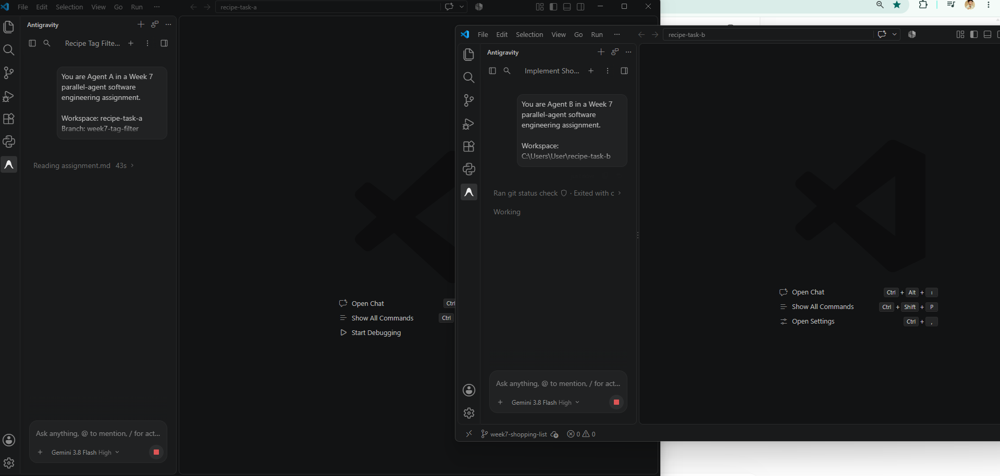
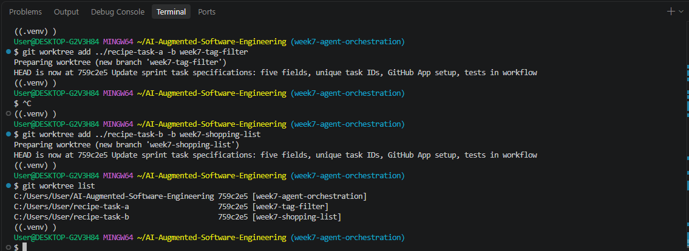

# Week 7 — Agent Orchestration: The Recipe Box Sprint

## Part I — Concurrent Agents

### Tasks Selected

I used two AI coding agents concurrently to implement independent features in the Recipe Box FastAPI application.

**Agent A — Tag Filter**

Implemented `GET /recipes?tag=breakfast`, allowing users to filter recipes by an exact tag while preserving the original behavior of `GET /recipes` without a filter.

**Agent B — Shopping List**

Implemented `GET /shopping-list?ids=1,2,3`, which combines ingredients from selected recipes into one list and removes duplicates.

### Worktree Setup

I created an integration branch called `week7-agent-orchestration` and two isolated Git worktrees:

```bash
git worktree add ../recipe-task-a -b week7-tag-filter
git worktree add ../recipe-task-b -b week7-shopping-list
```

The two agents worked in separate directories and branches. This allowed them to modify their own copies of the application without overwriting each other's changes.

I used separate Antigravity agent sessions to work on both tasks concurrently.

### Evidence of Concurrent Execution

**Screenshot 1 — Two agents working concurrently**



This screenshot shows Agent A working on the Tag Filter and Agent B working on the Shopping List in two separate Antigravity sessions. Both agents were active in their respective workspaces.

**Screenshot 2 — Git worktree isolation**



This screenshot shows the creation of two independent Git worktrees and the output of `git worktree list`, confirming that the integration branch and both agent branches were isolated in separate directories.

### Integration and Collision Handling

Both agents modified `starter/main.py` and `starter/test_main.py`, creating a potential integration collision.

Agent A's implementation was committed as `4fbba2c` and merged into the integration branch as `67f8aee`.

Agent B's implementation was committed as `8a408b1` and merged as `7d5dbbf`.

During the second merge, Git automatically merged `main.py` but reported a content conflict in `test_main.py`.

I inspected the conflict and preserved both sets of tests rather than discarding either agent's changes. I also retained the database-isolation fixture introduced during the generator–critic process.

After resolving the conflict, I ran the complete test suite.

**Integration result: 23 passed, 1 dependency deprecation warning.**

This demonstrated that Git worktrees prevent simultaneous editing collisions, but integration conflicts can still occur when independent agents modify the same files.

## Part II — Generator–Critic Loop

I applied the generator–critic workflow to Agent A's Tag Filter task.

The generator implemented the feature, and a separate critic reviewed it against three criteria:

1. Correctness of the implementation.
2. Quality, reliability, and coverage of tests.
3. Clarity and maintainability of the code.

### Initial Generator Implementation

The generator added tag filtering to the recipes endpoint using Python-side filtering.

The initial implementation passed seven tests, including the three original starter tests.

### Critic Review — Round 1

**Decision: REQUEST CHANGES**

The critic identified three issues:

- **High priority:** Tests used the persistent `recipes.db` database, creating a risk of test contamination and inconsistent results.
- **Medium priority:** The behavior of an empty tag query (`?tag=`) was ambiguous.
- **Medium priority:** Test coverage was incomplete for secondary tags, empty tags, and exact matching.

### Generator Revision — Round 1

The generator addressed the feedback by:

- Introducing an automatic pytest fixture that creates an isolated temporary SQLite database for each test.
- Defining empty and whitespace-only tag queries as requests for the complete recipe list.
- Adding tests for secondary tags, empty tags, and exact matching.

**Result: 12 tests passed.**

### Critic Review — Round 2

**Decision: APPROVE**

The critic verified that database isolation worked, the new edge cases were covered, and the tests were repeatable.

The critic also suggested an optional improvement: performing tag filtering directly in SQLite using `json_each` rather than filtering in Python.

### Generator Revision — Round 2

The generator implemented the additional improvement by replacing Python-side filtering with parameterized SQL using SQLite's `json_each` functionality.

The generator also added regression tests covering:

- Duplicate tags within a recipe.
- Tags containing special characters.
- Preservation of recipe ID ordering.

**Result: 15 tests passed.**

### Final Critic Review

**Decision: APPROVED FOR INTEGRATION**

The critic confirmed that the implementation met the correctness, test-quality, and clarity criteria.

The approved implementation was committed to Agent A's branch and later integrated with Agent B's work.

### Transcript Evidence

The generator–critic sequence was:

1. Generator initial implementation — 7 tests passed.
2. Critic Round 1 — requested changes for database isolation, empty-query behavior, and edge-case coverage.
3. Generator Revision 1 — implemented fixes; 12 tests passed.
4. Critic Round 2 — approved fixes and suggested an optional SQLite optimization.
5. Generator Revision 2 — implemented SQL filtering and additional regression tests; 15 tests passed.
6. Final critic — approved for integration.

The original Antigravity agent conversations contain the detailed feedback and revision history.

## Part III — Agent Autonomy and Human Supervision

I allowed each coding agent to implement its assigned feature, edit files in its own worktree, and run tests.

The generator was allowed to revise its implementation in response to critic feedback. The critic's role was limited to reviewing correctness, tests, and code clarity rather than independently replacing the generator's implementation.

I supervised the process by assigning independent tasks, checking that each agent used the correct worktree, reviewing test results, and controlling when changes were committed and merged.

I handled the integration conflict manually to ensure that both agents' contributions were preserved.

I also verified the combined application by running the complete pytest suite before finalizing the merge.

## Part IV — What I Learned

I learned that running multiple coding agents concurrently can speed up development when tasks are sufficiently independent. Git worktrees provide useful isolation because each agent works in a separate directory and branch, reducing the risk of overwriting another agent's changes. However, merge conflicts can still occur during integration, so human supervision remains important. The generator–critic loop improved the implementation by identifying database-isolation and test-coverage problems that were not addressed initially. I also learned that passing tests independently is not enough; the combined implementation must be tested after merging.

## Final Verification

- Agent A: Tag Filter implemented and merged.
- Agent B: Shopping List implemented and merged.
- Generator–critic: Two revision rounds and final approval.
- Integration: Both implementations preserved.
- Final test suite: **23 passed, 1 warning**.
- Integration branch: `week7-agent-orchestration`.

